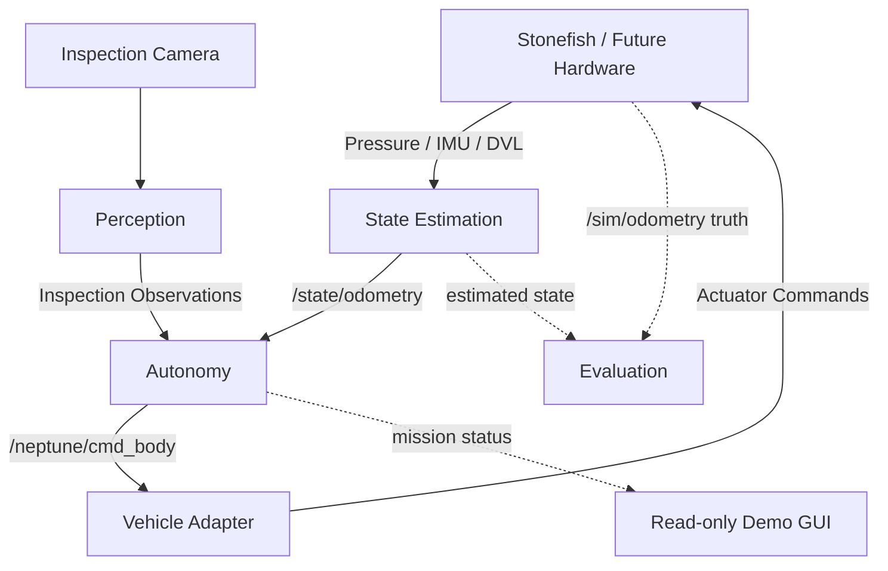

# Project Neptune

> **Simulation-first autonomous underwater inspection for Project Lumyn / Talon.**

Project Neptune is a modular ROS 2 autonomy stack for underwater inspection. It is designed around stable subsystem contracts so state estimation, autonomy, perception, vehicle integration, simulation, and evaluation can evolve independently without forcing the rest of the system to understand their internal implementation.

---

## Demo V0

**Current demonstrated mission**

`WAIT_FOR_STATE → DIVE → TRANSIT → INSPECT → RETURN → ASCEND → COMPLETE`

<!-- Replace the line below with your public/shared demo link -->
### [Watch the Demo](https://drive.google.com/drive/folders/1aLYxoOSWVyJHvu9ITIB_BnFWCTZHkvws?usp=drive_link)

<!-- Optional: replace this with a GIF, screenshot, or thumbnail -->
<!--
<p align="center">
  <a href="PASTE_DEMO_LINK_HERE">
    
  </a>
</p>
-->

The current integrated demo uses onboard estimated state for mission execution, drives a simulated underwater vehicle through Stonefish, and provides a polished operator-facing presentation view for system status and camera feedback.

---

## What Neptune Is

Neptune is a **simulation-first underwater autonomy stack** being developed under **Project Lumyn / Talon**.

The architecture separates:

- state estimation
- mission autonomy
- perception
- vehicle actuation
- simulation
- evaluation
- bringup / presentation tooling

The core rule is simple:

> **Modules work against contracts, not against each other's internal implementation.**

That means the estimator can eventually move from the current implementation to a validated operational ESKF without forcing autonomy to be rewritten, as long as `/state/odometry` keeps the same contract. Likewise, the vehicle backend can move from Stonefish to real hardware while preserving `/neptune/cmd_body`.

---

## Architecture



### Critical contracts

- `/state/odometry` is the **canonical navigation state**.
- `/sim/odometry` is **simulation truth for evaluation/debugging only**.
- Production autonomy must not use `/sim/odometry`.
- The mission executive is the sole normal publisher of `/neptune/cmd_body`.
- `neptune_vehicle` owns body-command → actuator translation.
- Perception publishes observations, not thruster commands.
- The GUI is read-only with respect to vehicle motion.

---

## Repository Layout

```text
src/
├── neptune_autonomy          # Mission executive, guidance, body commands
├── neptune_bringup           # Launch, readiness, GUI, demo composition
├── neptune_controls          # Reusable lower-level control laws
├── neptune_evaluation        # Metrics, truth comparison, benchmarking
├── neptune_interfaces        # Shared ROS interfaces
├── neptune_perception        # Inspection perception and fusion
├── neptune_sim               # Stonefish scenarios and simulator assets
├── neptune_state_estimation  # Sensor fusion and canonical state
├── neptune_vehicle           # Vehicle abstraction + actuator mapping
└── neptune_world             # Simulator-independent world abstractions
```

---

## Coordinate Convention

Canonical body convention:

```text
+X = bow / forward
+Y = starboard
+Z = down
```

`/neptune/cmd_body` semantics:

```text
linear.x   = surge
linear.y   = sway
linear.z > 0 = dive
angular.z  = yaw command
```

See [`docs/INTERFACES.md`](docs/INTERFACES.md) for the authoritative interface definitions and exact topic ownership.

---

## Quick Start

### Development platform

Current validated development environment:

- Windows 11
- WSL2
- Ubuntu 24.04
- ROS 2 Jazzy
- Stonefish
- NVIDIA RTX GPU via WSLg / D3D12

### Engineering demo

```bash
./scripts/run_demo_v0.sh
```

### Presentation demo

Current tested presentation build:

```bash
NEPTUNE_DEMO_INSTALL=/tmp/neptune-safe-presentation-install \
./scripts/run_demo_v0.sh --presentation
```

The presentation path preserves Stonefish at **1280×720** and repositions the window without resizing the underlying renderer. This avoids the sustained WSLg/D3D12 stalls observed with an oversized presentation viewport.

> The `/tmp/neptune-safe-presentation-install` path is currently an ephemeral tested install overlay and should eventually be replaced by a fully reproducible standard build/install workflow.

---

## Current Status

### Demo V0

- [x] Autonomous dive
- [x] Waypoint transit
- [x] Inspection phase
- [x] Return
- [x] Ascend
- [x] Complete
- [x] Read-only polished demo GUI
- [x] Safe presentation rendering path
- [x] Full engineering mission completed successfully

### State Estimation — Stage 2

- [x] S2.1 — Evaluation framework
- [x] S2.2 — Sensor degradation framework
- [x] S2.3 — DVL integration
- [x] S2.4 — IMU integration
- [x] S2.5 — Pressure integration
- [x] S2.6 — 15-state ESKF structure
- [ ] S2.7 — Operational ESKF integration + validation

The 15-state ESKF structure exists, but it is **not yet the fully validated operational estimator**.

### Perception

Current integrated perception work includes:

- inspection-class detection for pipe / valve / flange
- pipe-orientation model path
- fused inspection observations
- current P4 integration

Closed-loop P5 behavior remains deferred until the state-estimation and perception contracts are stable enough for reliable integration.

---

## Team Development Model

Each package owns its internal implementation but must preserve its public contract.

Examples:

```text
State Estimation
    │
    │  guarantees /state/odometry
    ▼
Autonomy
    │
    │  guarantees /neptune/cmd_body
    ▼
Vehicle
    │
    │  guarantees actuator translation
    ▼
Stonefish / Future Hardware
```

A teammate can replace an internal algorithm without understanding every other package, as long as:

- public topic names stay stable
- message types stay stable
- frames stay stable
- units stay stable
- sign conventions stay stable
- ownership rules stay stable

Any change to those is a **contract change** and requires cross-module review.

See [`docs/TEAM_CONTRACTS.md`](docs/TEAM_CONTRACTS.md).

---

## Known Issues

### WSLg / D3D12 rendering stalls

Stonefish occasionally exhibits short global sensor/render stalls under WSLg/D3D12.

Observed behavior during larger presentation rendering included simultaneous loss of:

- pressure
- IMU
- DVL
- camera
- `/sim/odometry`
- `/state/odometry`

The simulator process remained alive, and diagnostics observed the WSL DirectX synchronization path during sustained freezes.

The current presentation workflow stabilizes the demo by keeping Stonefish at **1280×720** instead of enlarging the render surface.

This is a mitigation of the trigger, not a claim that the underlying Stonefish/WSLg issue itself has been fixed.

### Source / install convention history

Camera, body-axis, and vehicle-install conventions have changed during development. Before modifying camera mounts, body conventions, or actuator mappings, verify the current source contracts and rebuild paths carefully.

---

## Next Priorities

1. Preserve the stable Demo V0 baseline.
2. Replace the temporary presentation install overlay with a reproducible build/install path.
3. Operationalize and validate the 15-state ESKF.
4. Continue perception evaluation.
5. Resume P5 closed-loop behavior.
6. Add hardware abstraction for real vehicle integration.
7. Transition simulator-specific actuation toward real subsea hardware interfaces.

---

## Documentation

- [`PROJECT_HANDOFF.md`](docs/PROJECT_HANDOFF.md) — current system status and handoff
- [`ARCHITECTURE.md`](docs/ARCHITECTURE.md) — system architecture
- [`INTERFACES.md`](docs/INTERFACES.md) — authoritative ROS contracts
- [`TEAM_CONTRACTS.md`](docs/TEAM_CONTRACTS.md) — module boundaries and change rules
- [`OWNERSHIP.md`](docs/OWNERSHIP.md) — team ownership model
- [`PROJECT_HISTORY.md`](docs/PROJECT_HISTORY.md) — preserved development history

---

## Project Lumyn / Talon

Project Neptune is developed under **Project Lumyn**, a student deep-tech robotics organization, as part of **Talon**, the subsea robotics team.

The long-term goal is to move from a validated simulation stack toward robust real-world underwater inspection autonomy while preserving the same high-level module contracts across simulation and hardware.

---

## Demo Link Placeholder

Replace this when ready:

```text
PASTE_DEMO_LINK_HERE
```

Optional additions for later:

```text
docs/media/demo-thumbnail.png
docs/media/neptune-architecture.png
docs/media/vehicle-cad.png
```

These can be embedded near the top of this README once the final public-facing assets are selected.
