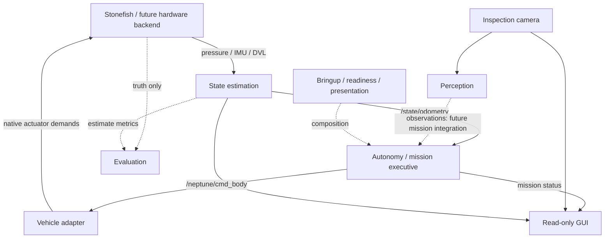

# Architecture

Neptune separates sensing, navigation state, mission decisions and actuator translation. The current backend is Stonefish; a future hardware backend must preserve the public contracts in [INTERFACES.md](INTERFACES.md).

Solid navigation/control arrows describe Demo V0's runtime data flow, not Python import dependencies. Perception-to-autonomy integration is deferred. Reusable `neptune_controls` nodes are alternative experimental controllers today; the mission calls guidance internally and does not import a controls layer between autonomy and the adapter.

## Boundaries

| Module | Responsibility |
| --- | --- |
| `neptune_state_estimation` | Sensor-derived canonical navigation state; current pressure/IMU/DVL dead reckoning, future operational ESKF. |
| `neptune_autonomy` | Mission sequencing and guidance using estimated state; one normal body-command publisher. |
| `neptune_vehicle` | Body-command semantics to backend-specific actuator mapping, including watchdog. |
| `neptune_perception` | Image-space inspection observations and fusion; no actuator authority. |
| `neptune_controls` | Reusable/experimental lower-level controllers, selected explicitly instead of mission command ownership. |
| `neptune_sim` | Simulator scenes/assets, performance profile and opt-in sensor degradation. |
| `neptune_bringup` | Composition, readiness, read-only GUI and presentation placement. |
| `neptune_evaluation` | Offline/live metrics and truth comparison with no production feedback. |
| `neptune_interfaces` | Reserved shared-definition directory; no current custom ROS definitions or package manifest. |
| `neptune_world` | Reserved backend-independent world abstractions; no current package manifest. |

## Actual dependencies and target layering

Most modules communicate using standard ROS messages rather than importing one another. Bringup declares runtime dependencies on autonomy, state estimation, vehicle and sim, and imports the simulator's profile generator. State estimation and readiness currently use `stonefish_ros2/msg/DVL`; this simulator-specific message coupling is transport debt, not permission to consume simulator truth. The state-estimation manifest does not yet explicitly declare that DVL dependency; the provisioned Stonefish underlay currently supplies it. No dependency cleanup is part of this baseline freeze.

The intended layering is shared interfaces supporting state estimation/perception, then autonomy, reusable control laws where appropriate, and the vehicle boundary. This is a design direction, **not a claim of current imports**. Sim/world/bringup provide infrastructure; evaluation observes without feeding truth into production algorithms. See [TEAM_CONTRACTS.md](TEAM_CONTRACTS.md) for change rules and tests.

## Runtime safeguards

Autonomy uses `/state/odometry` exclusively. Demo readiness checks finite sensor/state values, monotonic receipt freshness and exclusive publication ownership. The adapter zeros stale commands. The GUI is read-only for motion. P4/P5 are excluded from Demo V0. Safe presentation preserves a 1280×720 Stonefish window; rendering-driver stalls remain a known platform limitation rather than a navigation feature.
