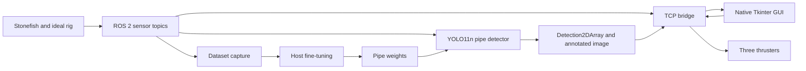

# Architecture

`src/neptune_sim` owns launch, fixed sensor TF, pressure-derived depth, and the reused GUI bridge. `src/neptune_perception` owns latest-frame inference and model status. `src/neptune_gui` owns native UI. `src/tools` owns automation and offline data tooling. `Simulation` holds geometry, scenario, Docker setup, and the authoritative rig description.

## Frames and timing

Stonefish uses `world_ned`: +z is down. `Neptune/base_link` uses forward/right/down, matching the physical scenario. Camera optical frames use right/down/forward; the forward cameras' rotation is roll π/2, pitch 0, yaw π/2. Do not assume ROS forward/left/up for this prototype.

Upstream robot TF provides world-to-body. The rig adapter makes one startup respawn request after physics initializes to clear initial-condition transients and establish the exact requested spawn; it never holds or controls pose afterward. The rig adapter provides fixed body-to-sensor transforms. Ground truth is an evaluation/data-labeling channel, never a YOLO input.

A documented upstream patch publishes `/clock` from physical simulation time, timestamps scalar measurements in that time domain, and renders all pending vision views in one scene snapshot. Camera callbacks use the previous render timestamp because image readback is buffered. All instruments start enabled; capture temporarily disables unused vision sensors and restores them afterward. Camera subscriptions use reliable transport to avoid large-message loss in Docker. Physics pacing remains wall-clock based. GUI command timeout remains monotonic wall time even when simulation pauses.

## Interfaces

| Topic | Type / purpose |
|---|---|
| `/neptune/camera/{left,right,down}/image_color` | `sensor_msgs/Image` |
| `/neptune/camera/{left,right,down}/camera_info` | `sensor_msgs/CameraInfo` |
| `/neptune/sonar/image`, `/display` | Native sonar images |
| `/neptune/imu` | `sensor_msgs/Imu` |
| `/neptune/pressure` | Gauge `sensor_msgs/FluidPressure` |
| `/neptune/dvl` | `stonefish_ros2/DVL` |
| `/neptune/altitude` | `sensor_msgs/Range` |
| `/neptune/depth` | Pressure-derived `std_msgs/Float64`, meters |
| `/neptune/ground_truth` | `nav_msgs/Odometry`, labeling/evaluation only |
| `/neptune/thrusters` | Three normalized `Float64MultiArray` values |
| `/neptune/perception/pipe_detections` | `vision_msgs/Detection2DArray` |
| `/neptune/perception/annotated` | `sensor_msgs/Image` |
| `/neptune/perception/status` | JSON `std_msgs/String` |

TCP port 9090 uses newline-delimited JSON. Existing `cmd`/`img`/`state` envelopes are preserved; `preview` selects raw or annotated video. Detection status contains state, reason, latency, and boxes. One-second command timeout and disconnect command zero thrust.

See [[Methods and Libraries]] and [[Known Issues and Fixes]].

## Switchable sensor errors and return

[[Sensor Errors and Return to Spawn]] documents the moderate error profile, ideal bypass, sensor-only pose comparison score, GUI controls and staged tank return. Actual outcomes are recorded separately from pending verification.

[[Tank Overview]] adds a fixed live tank camera below the forward GUI feed, 13 pt telemetry text and screen-aware scrolling. Actual camera/GUI checks are recorded in that note.
