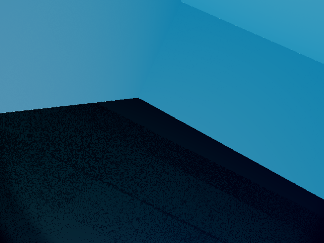

# Known issues and fixes

| Issue | Fix / status |
|---|---|
| ROS Node reserves `clients`; bridge assignment crashed | Rename to `gui_clients`; verified |
| Upstream timestamps messages with wall time | Publish physical `/clock` and stamp measurements with simulation time; verified |
| Upstream renders one queued non-continuous view per frame | Render pending views together, sharing captured-frame timestamps; verified: shared stereo stamps |
| Default underwater decorative particles | Disable this effect in the pinned patch for clear-water milestone |
| ROS dependency key `pcl` is unresolved by rosdep | Skip that key; desktop/PCL dependencies provide it; image builds |
| Apple GPU unavailable inside Docker | Host MPS training, CPU container inference |
| Camera/sonar delivery below configured 10 Hz on software rendering | Measure throughput; do not claim configured rate is achieved |
| Generic YOLO weights lack pipe class | Fine-tune one-class weights; explicitly reject generic models |
| Weights missing at startup | Run raw preview with unavailable status; train then restart |
| Sensors with enable services start disabled upstream | Start all Neptune instruments enabled in the integration patch |
| Large best-effort camera messages dropped in Docker | Reliable camera transport and 1 GB shared memory |
| Close-view labels included off-screen silhouette vertices | Clip the convex silhouette with OpenCV before computing the visible box; regression test added; affected views recaptured |

| macOS system Python uses Tk 8.5 and cannot display PNG previews | Launcher chooses Tk 8.6+; override with `NEPTUNE_GUI_PYTHON` |
| GUI retains thrust across reconnects | Reset local commands while disconnected; bridge also stops on disconnect |

| World-to-body TF was not enabled in the scene | Enable upstream `ros_base_link_transform`; runtime lookup verified at spawn |
| GUI preview capped at 5 FPS and resent identical frames | Separate 10 Hz image timer; send fresh frames only; GUI polls at 30 Hz and displays actual feed FPS |

| Initial-condition solving left startup body motion | One-time existing Stonefish respawn call after physics starts; zero-thrust pose verified stationary at requested spawn |

## Current limitations

This simulator uses ideal measurements and a simplified torpedo/thruster model. Ground truth is for labeling/evaluation, not operational perception. Pipe labels assume the configured unobstructed straight cylinder and cameras inside the tank; camera-plane crossings are rejected. The data pipeline intentionally avoids occluders and should not be reused for damaged or cluttered scenes without improving visibility labeling.

Software OpenGL can emit shader-link warnings; investigate image quality and capture results rather than treating startup alone as sufficient verification.

See [[Progress]], [[Setup]], and [[Experiments]].

## Orientation capture clock/render incident (2026-10-09)

Later rendered images repeated tank-wall pixels despite different requested poses and positive pipe labels. This invalidated the rendered labeling assumptions. A five-second observation received 16,284 ground-truth samples and showed a roughly 20-second image/pose lead; this was not the intended real-time ideal rig. Frame-time deltas first jumped at group 228.

All groups ≥228 were quarantined for recapture (1,311 images), preserving the first 2,280. All replacement captures have now passed local validation as part of the complete 6,000-image dataset. The user approved uploading verified replacement records; original quarantined images remain excluded. All 6,000 valid images are uploaded, with cloud labels being corrected before training. No candidate was trained or promoted. The monotonic-clock and bounded-catch-up correction passed full-rig runtime verification: approximately 100 Hz clock/IMU, 20 Hz pressure, 10 Hz DVL, and 54 matching stereo timestamps after restart. Duplicate-pixel and clock-pacing capture guards fail closed. The example below has no visible pipe despite its generated positive label and must not train the detector.

Restart a simulator after host sleep or a clock discontinuity before taking acceptance measurements. Capture completion re-enables peripheral sensors, but a stereo phase mismatch was observed after restoration. A clean full-rig restart restored exact stereo matches and passed verification; require this restart after capture.

## Cloud positive-label origin conversion

Positive VOC imports were shifted by approximately one pixel, up to 1.495 pixels after rounding. Refresh positive boxes as normalized YOLO TXT with explicit `0: pipe` mapping; preserve empty VOC negatives. A diagnostic re-export of the corrected sample differed by at most 0.166 pixels. Verify every box in the final full export before training; incomplete diagnostic versions 1 and 2 must not train.

## Roboflow model weight export denied — 2026-10-10

All three YOLO11n runs finished, but the official SDK PyTorch download returned HTTP 403: `Not authorized to download this model in pt format.` This is a provider authorization response, not a simulator/model-load failure. The exact entitlement cause is unconfirmed. No candidate weights have been downloaded or promoted. Temporary keys revoked and secret files deleted. User handoff requested: enable export access or supply each run’s weights locally. See [[Roboflow Training]] and [[Orientation Resume Checkpoint]].

## 2026-10-10 — live managed deployment

See [[Orientation Deployment Results]] for completed three-run held-out results, live CPU experiments, manual-control verification, unmet performance gates, and the COU transfer diagnostic. Accuracy passed; runtime gates failed, so the original default remains active.

## 2026-10-10 — manual mobility fix

[[Manual Control and Mobility]] records the hold-to-drive GUI, confirmed command bars, counter-rotating horizontal propellers, increased rotor authority and passive hull stability. All six physical directions, sustained straight travel, emergency stop, disconnect and native Tk repeat/release checks passed. These are simulator parameters, not measured Neptune hardware.

## Switchable sensor errors and return

[[Sensor Errors and Return to Spawn]] documents the moderate error profile, ideal bypass, sensor-only pose comparison score, GUI controls and staged tank return. Actual outcomes are recorded separately from pending verification.

Return's scalar sensor delivery initially stalled under camera corruption and reliable transport; a bounded image worker and sensor-data QoS resolved the measured return failure without widening watchdog limits. Brief modeled DVL lock loss is distinguished from a stopped stream. Disabling errors stops injection but preserves accumulated dead-reckoning drift. Return steers to correct lateral displacement, because the torpedo lacks a sway thruster. See [[Sensor Errors and Return to Spawn]].
