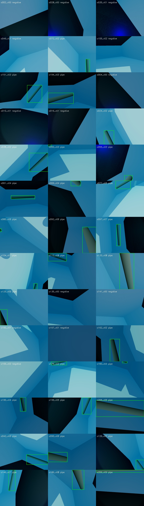

# Orientation detection

Related: [[Home]], [[Architecture]], [[Roboflow Training]], [[Experiments]], [[Known Issues and Fixes]], [[Orientation Resume Checkpoint]].

## Goal and method

Retain YOLO11n and correct the training distribution before experimenting with a new architecture. The former simulator positives covered yaw ±17°, pitch ±4° and no roll. Their earlier 100% recall does not establish performance under changed orientation.

Capture 6,000 actual Stonefish images from 600 independent viewpoint groups; split groups 70/15/15 (4,200/900/900 images), with 25% genuine pipe-absent frames. Sample roll ±180°, yaw offsets up to ±90°, pitch offsets up to ±45°, positions, distances and partial visibility. Stereo and other sensors remain ideal. Offline labels use known geometry and capture-time transforms; inference uses pixels only.

Cylinder edges are clipped at the camera near plane before projection. An uncertain crossing without geometry edges raises an error. Invalid captures are replaced deterministically while preserving group, split and angle quotas. They are never silently turned into negatives. The sampler currently retains primary-eligible positive targets; subthreshold distant targets need a separate challenge capture before claiming tiny-target performance.

## Implemented tooling

- `src/tools/orientation_views.py`: reproducible viewpoints and replacement candidates.
- `src/tools/capture_orientation.py`: resumable actual ROS image capture, labels and hashed manifest.
- `src/tools/validate_dataset.py`: image/label agreement, boundaries, hashes, group and duplicate split leakage.
- `src/tools/import_cou.py`: local COCO box conversion, sequence grouping and explicit reviewed-negative selection.
- `src/tools/make_comparison.py`: local mixed dataset with untouched simulator validation/test partitions.
- `src/tools/evaluate.py`: one-to-one IoU matching, angle/partial/distance slices, primary/small target reports and validation-only confidence selection.
- `src/tools/promote_model.py`: verifies exact weight identity, test acceptance and live runtime before replacing active weights; preserves rollback.

## Training and acceptance

Requested settings: pretrained YOLO11n, 100 epochs, image size 640, batch 16, seeds 42/43/44; no synthetic image corruption. The user approved Roboflow managed defaults for three repeat runs; batch, seed and online augmentation cannot be claimed as controlled. See [[Roboflow Training]]. Do not label provider repeats as controlled seed experiments.

Primary targets require both box dimensions ≥4 pixels and visible area ≥100 pixels. Targets: overall recall ≥95% at IoU ≥0.5, recall ≥90% in each populated projected-angle bin, and pipe-absent false-positive frame rate ≤5%. Report smaller targets separately. Confidence is selected on validation; test data does not choose the checkpoint or confidence.

Compare the candidate and baseline with the complete simulator running. Record fresh annotated GUI FPS and p95 inference latency. Current promotion guard requires no more than 10% frame-rate reduction or p95 latency increase, and matching live/evaluated confidence and weight hash.

## Observed results, not final acceptance

| Evaluation | Result | Limit |
|---|---|---|
| Original detector, 35 COU pipe frames | 0/35 detected at IoU ≥0.5 | Small transfer diagnostic; no negative-frame evaluation |
| Original detector, first 250 orientation test frames available during capture | 13/191 primary targets detected (6.81%); 0/59 false-positive negative frames | Incomplete capture snapshot, not the frozen 900-frame test |
| Host checks after orientation changes | 16 passed | ROS checks recorded separately; live GUI checks remain pending |

Reports are in ignored `outputs/cou-baseline-diagnostic.json` and `outputs/orientation-baseline-pilot.json`. Hardware: Apple M5, 16 GB RAM, 10 CPU cores; Docker uses 8 CPUs and Mesa 8 rendering threads. Host Python 3.12, Ultralytics 8.3.221, PyTorch 2.8.0, OpenCV 4.11 and NumPy 1.26.4. Standalone MPS inference timing is not full-rig GUI FPS.

## COU and paper gate

All 35 COU pipe images belong to G18. Keep that entire sequence together. The reviewed local training supplement is 50 G18 images plus 350 negatives from other original training sequences. Contact-sheet review does not prove complete annotations or independent real-world generalization. No COU-assisted cloud training is authorized until compatible privacy/licensing is available.

The MDP-YOLO paper reports marine-object gains, not pipe-specific deployment gains. Do not implement an approximate full architecture. If the corrected baseline still fails on thin/distant pipes, consider isolated verified [DySample](https://github.com/tiny-smart/dysample) and [MPDIoU](https://arxiv.org/abs/2307.07662) experiments. Promotion requires a ≥3 percentage-point challenging-subset recall gain across three runs, ≤1-point overall recall regression, ≤5% negative-frame FPR and ≤10% live p95 latency increase.

## Rendered label review

A 42-frame contact-sheet sample was visually reviewed at approximately 2,000 captures. Boxes matched visible rotated and partial pipes in that sample; it is not exhaustive annotation verification.

ROS integration: missing-model status, fresh 10 Hz TCP previews without duplicate frames, watchdog/disconnect stopping with a paused clock, and clean process exits all passed in an isolated ROS domain. Two launch modules ran three behavior tests and two post-shutdown exit-code tests. Log: `outputs/ros-orientation-tests.log`. These checks do not measure the full simulator GUI frame rate.

## Complete dataset and baseline outcomes

All 6,000 simulator images passed local validation: 600 groups; train/val/test 4,200/900/900; negatives 1,050/225/225; all six angle bins populated; zero duplicates. Manifest SHA256: `1ca3375ab2314315e2a9f3dac08d1cbce30502a2f41d3c29d5decc41d89f74f9`. The unchanged old model achieved 7.11% eligible-pipe recall and 0.44% pipe-absent false-positive frames on the full 900-image test set at confidence 0.25. Warm MPS inference averaged 15.34 ms, p95 22.27 ms on the recorded Mac; this is offline MPS timing, not live Docker latency. Baseline failed orientation recall acceptance. The local COU-assisted dataset contains 6,400 images (4,600/900/900), including 35 real pipe-positive images, and remains local-only. No new model trained or promoted yet.
