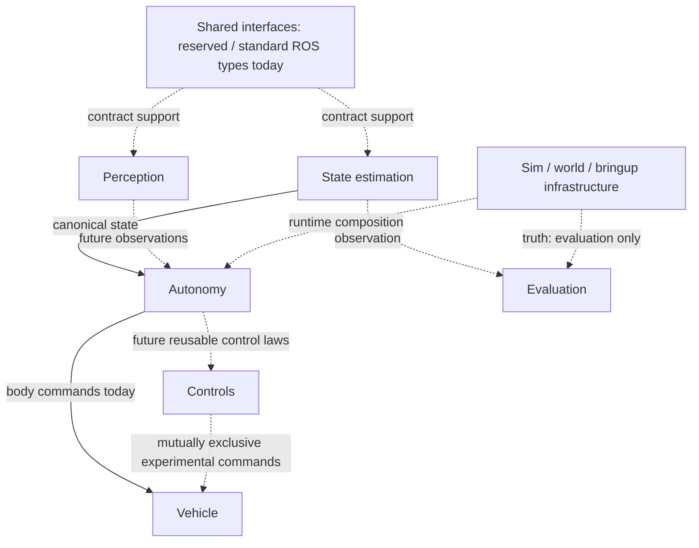

# Team Contracts

A module may change its internal implementation freely as long as its external contract remains satisfied. **Teammates work against contracts, not other modules’ internals.** [INTERFACES.md](INTERFACES.md) is authoritative for ROS boundaries; [OWNERSHIP.md](OWNERSHIP.md) assigns review responsibilities by role.

## Package contracts

### neptune_state_estimation

#### OWNS

Sensor fusion and canonical `/state/odometry`; pressure depth and IMU/DVL dead reckoning today.

#### CONSUMES

Pressure, IMU and sensor-frame DVL; intermediate `/estimate/depth`. No production truth input.

#### PRODUCES

`/estimate/depth`, `/state/odometry`.

#### MAY CHANGE INTERNALLY

Replace fusion algorithms, including operational ESKF, without autonomy changes if the canonical-state contract remains satisfied.

#### MUST NOT CHANGE WITHOUT CROSS-MODULE REVIEW

State topic/type/frames/units/origin/validity/timing. Must not change body-command semantics or actuator mapping, or use truth as the production estimate. Legacy truth-backed entry points are excluded from production.

#### REQUIRED TESTS

ESKF structure/unit tests; sensor transforms, depth and source-time integration regressions; estimate-vs-truth evaluation in evaluation only before operational algorithm acceptance.

### neptune_autonomy

#### OWNS

Mission executive, mission states/transitions, guidance and high-level body-command generation.

#### CONSUMES

Canonical estimated state; demo readiness. Perception/health beyond existing readiness only when explicitly integrated; current mission does not subscribe to perception.

#### PRODUCES

`/neptune/cmd_body`, `/neptune/mission/status`; demo start Trigger service.

#### MAY CHANGE INTERNALLY

Guidance internals within unchanged command/state/safety/route contracts.

#### MUST NOT CHANGE WITHOUT CROSS-MODULE REVIEW

Mission state meaning, route/arrival/dwell, command signs/units/ownership or freshness behavior. Must not guide from `/sim/odometry` or write native thrusters directly.

#### REQUIRED TESTS

Guidance/speed/bow tests, full transition and startup/freshness tests, typed ROS boundary/truth-isolation contracts. Bounded integration before behavior changes.

### neptune_vehicle

#### OWNS

Vehicle abstraction and body-command → native actuator/hardware mapping; Stonefish adapter today.

#### CONSUMES

`/neptune/cmd_body`.

#### PRODUCES

`/sim/thruster_setpoints` today; future backend-reviewed hardware output.

#### MAY CHANGE INTERNALLY

Backend replacement, including future BlueOS/ArduSub/hardware, while preserving the body-command contract and safety behavior.

#### MUST NOT CHANGE WITHOUT CROSS-MODULE REVIEW

Body command interpretation, actuator signs/order/count/limits and watchdog semantics. Must not contain mission sequencing.

#### REQUIRED TESTS

5/7-motor mapping, bow-positive force, positive-yaw moment, bounded allocation, watchdog and shutdown zeros; backend integration before replacement.

### neptune_perception

#### OWNS

Camera-derived inspection observations, detector/A1 inference and fusion internals.

#### CONSUMES

Inspection Image; model status streams for fusion. No production truth/navigation dependency.

#### PRODUCES

Detection/annotated/status and fused observation topics listed in INTERFACES.md.

#### MAY CHANGE INTERNALLY

Replace neural architecture/backend and fusion internals while preserving observation schema, source provenance, freshness and validity semantics.

#### MUST NOT CHANGE WITHOUT CROSS-MODULE REVIEW

Observation topics/types/coordinates/classes/units/validity/provenance/timing. Must not command actuators directly or imply an angle from unsupported A1 output.

#### REQUIRED TESTS

Core/backend-secret/detector/A1/fusion unit and ROS adapter tests; model evaluation evidence. No inference server or simulator required for mocked unit tests.

### neptune_sim

#### OWNS

Stonefish scenarios, simulator configuration/assets, performance profile and opt-in degradation tooling.

#### CONSUMES

Native thruster setpoints; scenario configuration.

#### PRODUCES

Raw sensors, truth, camera and native actuator telemetry via Stonefish; optional separate degraded streams.

#### MAY CHANGE INTERNALLY

Backend-specific assets/configuration only while preserving approved physical/sensor boundary behavior.

#### MUST NOT CHANGE WITHOUT CROSS-MODULE REVIEW

Sensor frames/rates/noise/units, body geometry, physical actuator mapping, camera extrinsics or rendering defaults. Must not make production algorithms depend on simulator truth.

#### REQUIRED TESTS

Degradation and profile unit tests, scene/motor/mount contracts, safe geometry integration tests; simulation acceptance for physics/sensor changes.

### neptune_bringup

#### OWNS

Launch/composition, readiness, demo startup/presentation integration and read-only demo GUI.

#### CONSUMES

Sensor/state/mission/perception interfaces as explicitly configured; current Demo GUI uses raw camera and state/status/health.

#### PRODUCES

Ready/health topics, static TF, process composition; GUI display only.

#### MAY CHANGE INTERNALLY

Layout/read-only display implementation and orchestration when interfaces and safety remain satisfied.

#### MUST NOT CHANGE WITHOUT CROSS-MODULE REVIEW

Other modules’ topic/frame/sign semantics, ownership, readiness guarantees or normal launch composition. Must not silently redefine interfaces or give GUI motion authority.

#### REQUIRED TESTS

Readiness and demo ROS tests; orientation, presentation and launcher argument tests; pure PowerShell placement tests when available; no real window/simulator needed for geometry checks.

### neptune_controls

#### OWNS

Reusable lower-level control laws as introduced; current standalone depth/waypoint controllers and experimental P5a alignment.

#### CONSUMES

Canonical state and explicit standalone targets; fused observations for opt-in centering.

#### PRODUCES

Alternative body commands only under exclusive controller selection; dedicated alignment command/status by default.

#### MAY CHANGE INTERNALLY

Control-law internals within accepted stability, authority and public command contracts.

#### MUST NOT CHANGE WITHOUT CROSS-MODULE REVIEW

Command semantics, exclusive publication ownership, observation interpretation, gains/limits with observable behavior changes. Must not own mission sequencing.

#### REQUIRED TESTS

Pure centering and ROS node freshness/stop tests; standalone control regressions and bounded dynamic acceptance before activation. Never run alternative command owners with Demo mission.

### neptune_evaluation

#### OWNS

Metrics, truth comparison, benchmarking and evaluation evidence.

#### CONSUMES

May consume `/sim/odometry` and `/state/odometry`; relevant logs/sensors.

#### PRODUCES

Evaluation reports/files; no production control or state authority.

#### MAY CHANGE INTERNALLY

Metric implementations and report internals with stable documented definitions.

#### MUST NOT CHANGE WITHOUT CROSS-MODULE REVIEW

Metric definitions used for acceptance, dataset/benchmark semantics or interfaces. Must not feed truth into production autonomy or estimation.

#### REQUIRED TESTS

Localization metrics/evaluator, DVL benchmark and lateral-motion unit tests; deterministic report checks.

### neptune_interfaces

#### OWNS

Shared custom ROS messages/services/actions when required. Currently reserved directory with no package manifest or generated definitions.

#### CONSUMES

None currently.

#### PRODUCES

None currently. Standard ROS and Stonefish transport types are used directly elsewhere.

#### MAY CHANGE INTERNALLY

Draft definitions in isolated review branches; no current runtime implementation to refactor.

#### MUST NOT CHANGE WITHOUT CROSS-MODULE REVIEW

Any published shared definition or ownership/schema change automatically needs cross-module review.

#### REQUIRED TESTS

On introduction: message generation/build, compatibility and producer/consumer contract tests; currently no build/test target.

### neptune_world

#### OWNS

Backend-independent world/environment abstractions when introduced. Currently reserved directory with no package manifest.

#### CONSUMES

None currently.

#### PRODUCES

None currently; simulator world assets live in neptune_sim.

#### MAY CHANGE INTERNALLY

Future internal representation under reviewed public boundaries.

#### MUST NOT CHANGE WITHOUT CROSS-MODULE REVIEW

New shared environment frames/schema/semantics and any introduction of runtime dependencies.

#### REQUIRED TESTS

On introduction: representation/frame tests and downstream integration; currently no build/test target.

## Dependency direction

This diagram shows contract direction, **not current Python imports or package dependencies**. In current source, autonomy directly publishes to the vehicle boundary and does not depend on controls/perception packages. Bringup declares autonomy/state-estimation/vehicle/sim runtime dependencies and imports sim profile generation. State estimation/readiness import Stonefish DVL transport; the missing explicit state-estimation manifest declaration is known dependency debt. Interfaces/world are reserved directories, not functioning shared libraries. Evaluation observes and must never close a production loop using truth. No new imports or dependency changes are introduced by these contracts.

## Change protocol

### SAFE INTERNAL CHANGE

An algorithm/refactor is internal when topic names, message types, frames, units, sign semantics and ownership remain unchanged and externally observable behavior still satisfies the contract. The package owner may develop independently after appropriate package tests pass. An algorithm replacement still needs its stated quality/stability acceptance; matching message fields alone does not prove equivalent behavior.

### CONTRACT CHANGE

Any change to topic/type/frame/units/sign, publication ownership, mission state meaning, command semantics, or a required timing/rate guarantee is a contract change. It requires:

1. `INTERFACES.md` updated in the same PR.
2. Affected package and boundary tests updated.
3. Notification/review by downstream module owners and Technical Lead / Integration.
4. An integration test before merge.

Cross-module PRs identify affected owners explicitly. Future hardware backends must preserve public body semantics rather than leaking backend sign changes into autonomy. Rate expectations in the current interfaces are nominal, not promises that WSLg rendering cannot stall.

## Global invariants

Verified against current mission guidance, adapter, approved demo composition and tests:

- Body +X bow/forward, +Y starboard, +Z down.
- Positive body `linear.z` means dive; positive yaw remains about +Z.
- Canonical navigation state is `/state/odometry`.
- `/sim/odometry` is truth for evaluation/debug only; it never drives production autonomy or estimation.
- One normal body-command publisher: mission executive. Standalone alternatives are mutually exclusive.
- Vehicle owns actuator translation; mission/perception/GUI never write native thrusters.
- GUI cannot command the vehicle.

Legacy truth-backed estimator executables remain physically present but are excluded from approved production composition. Camera override history does not redefine body +X; its retained -X mount is an explicit source/install caveat. These existing limitations are recorded in [PROJECT_HANDOFF.md](PROJECT_HANDOFF.md) rather than hidden by a documentation-only freeze.

## Baseline verification

Existing focused tests lock down surge/yaw signs, native allocation, authority, receipt freshness, mission transitions, GUI read-only behavior and safe 1280×720 launch geometry. The boundary contract test additionally checks actual typed ROS endpoint declarations, sole approved motion owners and canonical-state/truth isolation without running Stonefish. Build/unit tests do not substitute for operational ESKF or P5 dynamic validation, which remain deferred.
